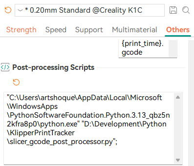
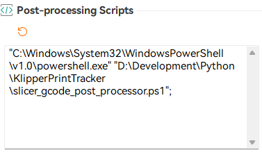
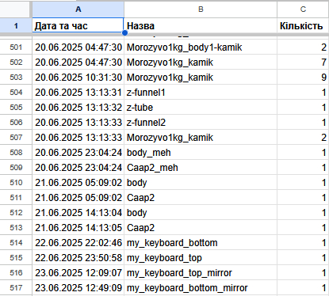

# KlipperPrintTracker

**Klipper-focused 3D print tracker** for counting individual parts from G-code and logging print outcomes to Google Sheets.

This project provides a set of scripts to automate reporting of 3D print job data from your Klipper-powered printer. It integrates with your slicer’s post-processing features and the [Klipper G-code Shell Command Plugin](https://guilouz.github.io/Creality-Helper-Script-Wiki/helper-script/klipper-gcode-shell-command/) to extract print metrics and push them into a centralized Google Sheet for tracking and analysis.

---

## 🧠 How It Works

1. In your slicer, enable the **"Exclude objects"** feature. This causes the generated G-code to include metadata for each object on the build plate.
2. The `slicer_gcode_post_processor` script parses this metadata and generates a JSON-like string containing the object list.
3. It then injects a call to the `INCREMENT_PRINT_COUNT` G-code macro with the `ITEMS` argument set to this object data.
4. Once the print completes, the `INCREMENT_PRINT_COUNT` macro is invoked by Klipper.
5. This triggers the execution of `klipper_post_print_reporter_invoke.sh`, which in turn runs the `klipper_post_print_reporter.py` script.
6. The Python script parses the JSON and sends the print data to the configured destination — by default, a Google Sheet.
7. The script can be customized to send data to other systems (e.g., databases, local files, REST APIs) instead of or in addition to Google Sheets.

---


## ✅ Current Status

### Done
- `slicer_gcode_post_processor.py` — Injects reporting commands into G-code as a slicer post-processing step.
- `slicer_gcode_post_processor.ps1` - PowerShell alternative for users without Python on Windows systems.
- `klipper_post_print_reporter.py` — Collects print metadata and sends it to Google Sheets from the Klipper host.
- `klipper_post_print_reporter_invoke.sh` — Simple shell wrapper to invoke the reporting script.
- `gsheet_data_handler.gs` — Google Apps Script to append print data as a new row in a Google Sheet.

---

## ⚠️ Current Limitations and Known Issues

1. The script does **not track the actual print success or failure of individual objects** — only that they were scheduled to print. If some objects print poorly and you exclude them during the print (using "Exclude Object"), this will **not be reflected automatically** in the report. In such cases, you need to **manually correct** the data in the Google Sheet or adjust the script to allow manual review before reporting.

---


## ⚙️ Setup Instructions

### 1. Create Google Sheet and App Script

1. Open [Google Sheets](https://sheets.google.com) and create a new spreadsheet.
2. Navigate to **Extensions > Apps Script**.
3. Delete any existing content in `Code.gs`, then paste the contents of `gsheet_data_handler.gs`.
4. Save the project via **File > Save project**.

---

### 2. Deploy Your App Script as a Web App

1. In the Apps Script editor, click **Deploy > New deployment**.
2. Select **Web app** as deployment type.
3. Configure:
   - **Description**: (Optional) e.g. `Klipper Print Reporter API`
   - **Execute as**: `Me`
   - **Who has access**: `Anyone`
4. Click **Deploy** and authorize access when prompted.
5. Copy the **Web app URL** — you’ll need it later.

---

### 3. Install the [Klipper G-code Shell Command Plugin](https://guilouz.github.io/Creality-Helper-Script-Wiki/helper-script/klipper-gcode-shell-command/)

Ensure your Klipper setup includes **Moonraker** and a compatible UI like **Mainsail** or **Fluidd**.

Follow the plugin's documentation to install it properly using the Creality Helper Script or manually.

---

### 4. Upload Reporting Scripts to Your Klipper Host

Place the following files in a suitable directory on your Klipper host (e.g., `/usr/data/printer_data/config/`):

- `klipper_post_print_reporter.py`
- `klipper_post_print_reporter_invoke.sh`

> ⚠️ **Important**: Edit both files and update paths as necessary, including the Web App URL from Step 2.

---

### 5. Add Post-Processing Script to Slicer

1. Open your slicer.
2. Locate the printer settings or output options where you can specify a post-processing script.
3. Add the full path to Python/Powershell and `slicer_gcode_post_processor.py`/`slicer_gcode_post_processor.ps1` as a post-processing script.

Python example



Powershell example




---

### 6. Update Klipper G-code Macro Config

1. Edit your `printer.cfg`.
2. Add the necessary G-code shell command and macro definitions.
   - Make sure `invoke_increment` points to the correct path of `klipper_post_print_reporter_invoke.sh`.
```
    [gcode_shell_command invoke_increment]
    command: sh /usr/data/printer_data/config/klipper_post_print_reporter_invoke.sh
    timeout: 30.0
    verbose: True

    [gcode_macro INCREMENT_PRINT_COUNT]
    gcode:
      
        
        RUN_SHELL_COMMAND CMD=invoke_increment PARAMS="{items}"
      
        {action_respond_info("Parameter 'ITEMS' is required")}
      
```
3. Save the file and restart Klipper.

---

### 7. Final Path Check

Double-check all paths in the following files:
- `slicer_gcode_post_processor.py`
- `klipper_post_print_reporter.py`
- `klipper_post_print_reporter_invoke.sh`
- `printer.cfg`

Ensure they match your file locations and that the Web App URL is correctly configured.

---

## 🔧 Customization

- You can modify `slicer_gcode_post_processor.py` to track additional parameters or simplify the command injection.
- Adjust `gsheet_data_handler.gs` to match your Google Sheet’s expected column order and data types.

---

## Result




# KlipperPrintTracker

Трекер 3D-друку з фокусом на Klipper для підрахунку окремих деталей із G-коду та логування результатів друку.

Цей репозиторій містить набір скриптів для автоматизованого надсилання даних про 3D-друк із вашого принтера на базі Klipper безпосередньо в Google Таблицю. Він інтегрується з постобробкою слайсера та плагіном G-code shell команд для Klipper, щоб збирати метрики друку та надсилати їх у централізовану таблицю для відстеження й аналізу.

---

## 🧠 Як це працює

1. У слайсері увімкніть функцію **"Exclude objects"** (виключити об'єкти). Це призведе до того, що згенерований G-code включатиме метадані для кожного об'єкта на платформі.
2. Скрипт `slicer_gcode_post_processor.py` зчитує ці метадані та формує рядок у форматі, подібному до JSON, який містить список об'єктів.
3. Потім цей скрипт додає виклик G-code макроса `INCREMENT_PRINT_COUNT` з аргументом `ITEMS`, що містить сформовані дані об'єктів.
4. Після завершення друку макрос `INCREMENT_PRINT_COUNT` викликається Klipper'ом.
5. Це запускає виконання скрипта `klipper_post_print_reporter_invoke.sh`, який, у свою чергу, запускає `klipper_post_print_reporter.py`.
6. Python-скрипт розбирає JSON і надсилає дані про друк на вказану ціль — за замовчуванням у Google Sheet.
7. Скрипт можна змінити, щоб надсилати дані в інші системи (наприклад, бази даних, локальні файли, REST API) замість або разом із Google Sheets.

---

## Поточний статус

**Зроблено:**
- `slicer_gcode_post_processor.py`: Python-скрипт для постобробки G-коду у слайсері, який вставляє команди звітності.
- `slicer_gcode_post_processor.ps1` - PowerShell-скрипт постобробки для користувачів, які не мають Python або надають перевагу PowerShell на Windows.
- `klipper_post_print_reporter.py`: Python-скрипт, який запускається на хості Klipper, відповідає за збір даних і надсилання їх у Google Таблицю.
- `klipper_post_print_reporter_invoke.sh`: Простий shell-скрипт для виклику `klipper_post_print_reporter.py`.
- `gsheet_data_handler.gs`: Google Apps Script для прийому даних з хоста Klipper і додавання нового рядка в зазначену Google Таблицю.

---

## ⚠️ Поточні обмеження та недоліки

1. Скрипт не відслідковує статус успішності друку окремих об'єктів — лише те, що вони були заплановані до друку. Якщо під час друку деякі об'єкти виходять неякісними, і ви виключаєте їх прямо під час друку (через "Exclude Object"), ця інформація **не враховується автоматично**. У такому випадку потрібно **вручну відкоригувати** дані в Google Sheet.

---


### Інструкція з налаштування

#### 1. Створіть Google Таблицю та Apps Script

- Створіть нову таблицю в [Google Sheets](https://sheets.google.com).
- Перейдіть до **Розширення > Apps Script**.
- Видаліть стандартний вміст (файл `Code.gs`) і вставте вміст `gsheet_data_handler.gs` у редактор Apps Script.
- Збережіть проєкт (**Файл > Зберегти проєкт**).

#### 2. Опублікуйте Web App

- У редакторі Apps Script натисніть **Розгортання > Створити нове розгортання**.
- Виберіть тип: **Web app**.
- Налаштуйте параметри:
  - **Опис**: (за бажанням) Наприклад, “Klipper Print Reporter API”.
  - **Виконувати від імені**: Я (ваш Google-акаунт).
  - **Хто має доступ**: Усі (щоб принтер міг надсилати дані без авторизації).
- Натисніть **Розгорнути**.
- Підтвердьте дозволи, якщо буде запит.
- Після публікації скопіюйте **URL веб-додатку** – він знадобиться на наступному кроці.

#### 3. Встановіть плагін "[Klipper Gcode Shell Command](https://guilouz.github.io/Creality-Helper-Script-Wiki/helper-script/klipper-gcode-shell-command/)"

- Переконайтеся, що у вас встановлені Moonraker і Mainsail/Fluidd.
- Встановіть плагін згідно [офіційної інструкції](https://guilouz.github.io/Creality-Helper-Script-Wiki/helper-script/klipper-gcode-shell-command/).

#### 4. Завантажте скрипти на хост Klipper

- Завантажте `klipper_post_print_reporter.py` та `klipper_post_print_reporter_invoke.sh` у директорію на хості Klipper, наприклад: `/usr/data/printer_data/config/`.
- Відкрийте обидва файли та переконайтесь, що шляхи до файлів і Web App URL із кроку 2 вказані правильно.

#### 5. Додайте скрипт постобробки у слайсер

- Відкрийте налаштування вашого слайсера.
- У розділі постобробки вкажіть шлях до Python/Powershell та `slicer_gcode_post_processor.py`/`slicer_gcode_post_processor.ps1` як скрипт обробки після слайсингу.

Python приклад


Powershell приклад


#### 6. Оновіть конфігурацію макросів у Klipper

- Відкрийте `printer.cfg`.
- Додайте наступний G-code shell command і макрос. Замініть шлях до `klipper_post_print_reporter_invoke.sh`, якщо ваш інший:

```
    [gcode_shell_command invoke_increment]
    command: sh /usr/data/printer_data/config/klipper_post_print_reporter_invoke.sh
    timeout: 30.0
    verbose: True

    [gcode_macro INCREMENT_PRINT_COUNT]
    gcode:
      
        
        RUN_SHELL_COMMAND CMD=invoke_increment PARAMS="{items}"
      
        {action_respond_info("Parameter 'ITEMS' is required")}
      
```

- Збережіть файл `printer.cfg` і перезапустіть Klipper.

#### 7. Фінальна перевірка шляхів

- Перевірте всі шляхи до файлів у:
  - `slicer_gcode_post_processor.py`
  - `klipper_post_print_reporter.py`
  - `klipper_post_print_reporter_invoke.sh`
  - `printer.cfg`

---

### Налаштування під себе

Ви можете змінити `slicer_gcode_post_processor.py`, щоб додати або прибрати параметри залежно від того, що саме хочете відстежувати. Аналогічно, змініть `gsheet_data_handler.gs`, щоб адаптувати порядок колонок та типи даних під вашу Google Таблицю.

---

## Результат

